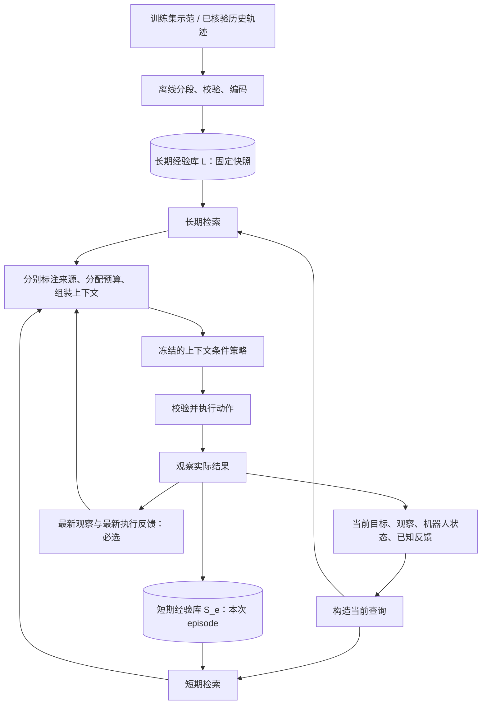

# RoboRAG：独立长期库与执行期短期库

状态：已实现双库核心与 RoboDojo 视觉控制闭环。纯 Python 合成原型用于边界测试；真实执行细节见 [runtime](runtime.md)，原生成绩见 [results](results.md)。以下明确区分当前实现与后续研究。

## 1. 边界与生命周期

长期库 L 在执行前构建。它包含训练集中的示范、经筛选的历史成功/失败恢复片段，使用有版本的存储快照和索引。一次实验固定 L，运行时仅查询。每条记录保留原始 episode 和数据划分，不允许测试轨迹在同轮评测中回流。

短期库 S_e 绑定唯一 episode e，开始时为空。每次动作及其反馈被观察到后，追加完整交互。其检索范围覆盖本次 episode 已发生的历史，而非只读最近的窗口。结束时关闭并释放；需要留存的原始日志由独立的日志系统处理，不直接变成下一次执行的短期记忆。

两套库具有独立的写入入口、数据集合、检索调用和预算。可以共享表示模型及记录结构。使用同一种 embedding 不意味着将两套库混合。

未来可增加离线整理流程：历史日志 → 结果核验 → 去重 → 数据划分检查 → 新长期库版本。首版不自动晋升，也不在 episode 内更新长期索引。

## 2. 数据流



当前已打通图中的数据入库、冻结视觉编码、双路检索、模型调用、动作执行和原生评分。核心合成原型使用词项检索；机器人接入使用 RGB 特征与实际本体状态，两者不是同一性能实验。

## 3. 如何先构建长期 RAG 库

第一阶段选择同一机器人、同一相机配置及同一动作接口，避免一开始承担跨 embodiment 对齐问题。初始数据只来自训练划分，不要求先拥有在线学习系统。

1. **整理源轨迹**：保存任务指令、相机标识/标定、时间戳、关节/夹爪/末端状态、实际执行动作及可核验结果。当前小规模 JSON 库嵌入源 JPEG 与特征，存在重复图像；规模扩大后改为内容哈希寻址的共享媒体存储。
2. **先划分再切片**：以原始 episode 为最小划分单位；需要测试新物体、新布局、新任务时，在相应层级隔离。随后再切片，避免相邻片段跨 train/test 泄漏。
3. **构建经验单元**：首选短轨迹片段，保留起始状态、动作、执行反馈及结束状态；episode 摘要作为元数据。初版可用固定窗口；后续比较抓取、接触、释放等事件边界。
4. **表示与索引**：长期检索 key 使用任务、片段起始视觉/几何状态、操作阶段和动作接口；value 保留完整动作与结果。候选片段的已知结果可用于质量评估，当前测试动作的未来结果不能进入查询。
5. **构建快照**：记录来源数据版本、划分、分段参数、编码器版本、坐标系、单位、索引参数与校验和。新增数据生成新版本；运行使用固定版本。
6. **离线检查检索**：检查同状态检索、困难负例、近似外观但不兼容的物体姿态，以及没有相关经验时的退化行为，再接入控制。

当前采用本地 JSON 快照和精确扫描。机器人库包含三视角 ResNet-18 特征，以及保留空间顺序的头部画面 2×2 特征；编码器冻结并在 CPU 上运行。没有规模测量前不引入数据库服务依赖。

## 4. 经验单元与查询

目标数据结构包含：

- provenance：记录 ID、episode ID、原始轨迹区间、来源类型、数据划分。
- compatibility：机器人型号、关节/夹爪定义、动作空间、坐标系、单位、相机配置及表示版本。
- retrieval key：目标语义、起始视觉/几何特征、阶段；短期查询还可包含已观察的错误与接触状态。
- value：前后观察与本体状态、提议动作与实际执行范围、控制器反馈、结果标签及证据。
- links：同一轨迹的前后片段、失败与随后恢复的关联，防止把恢复动作与触发条件拆开。

纯 Python 原型中的观察和动作是合成数据。真实库使用 `source_sha256`、`start/end`、前后 RGB/机器人状态、动作张量及相机标定。动作接口为双 ARX X5 的 link6 世界坐标末端增量，单位 m/rad，25 Hz；入库检查动作边界和数据频率。公开轨迹未被独立回放核验时，结果保留为未标注示范，不伪造成功标签。

当前查询 q_t = (任务目标，当前观察/本体状态，已观察交互)。V3 从 RGB/本体状态相似度更新源轨迹对齐游标；它不是环境提供的任务阶段标签，也不代表已验证任务进度。检索与模型均不读取当前场景物体真值位姿或奖励。

## 5. 两路检索

长期路关注“过去哪些操作可为当前状态提供参考”。当前先加载指定任务的训练库并检查 horizon、表示版本和训练划分；按初始画面空间特征选择一条源轨迹，回合内固定该来源与标定，再按当前三视角特征、本体状态及源对齐游标选择片段。初始和终末片段保留为过程参照。后续加入显式操作角色、相对几何、动作可执行性和结果质量重排。失败样本要标注为失败证据，不能按成功动作呈现。

短期路关注“本次执行哪些已发生的交互与当前问题相关”。它可找回早期目标、过去成功抓取的姿态、已经失败过的尝试及恢复记录。先过滤 episode 与时间，再进行相关性排序；新近程度可以作为特征，但不能让检索退化为仅取最近 K 条。

当前采用确定性的两路配额，不直接比较不同检索器的原始分数。核心原型支持无候选返回空；真实视觉接入目前对已选任务库取最近片段，尚无经过验证的拒绝阈值。短期选中片段按时间顺序呈现，并保留原始步数，明确省略区间；未选中区间保留执行/意图摘要。长期片段明确标注为独立 TRAIN 来源，不假装是当前轨迹的连续历史。

真实检索使用源哈希与区间标识记录，加入时间间隔约束以减少相邻重复片段；最新短期记录必选，不再占用其他检索位置。语义近重复、不同源轨迹配额、多段恢复链仍待评估。

## 6. 预算与上下文

上下文固定包含任务、当前观察/状态与最新完成交互的反馈。最新反馈不依赖相似度命中，即使是失败也必须可见。

其余部分分别是 `long_term_examples` 与 `short_term_retrieved`，保持来源标签。初版配额参数是 `long_term_k` 和 `short_term_k`，后者包含必选的最新交互。检索历史中的失败仅作为证据；动作需要策略结合当前状态重新生成。

配额约束片段数量，上游序列化器检查实际图片/文本/请求体大小；本轮默认图像上限为 50 张，实际 token 消耗由传输日志记录。达到已配置的硬上限会拒绝请求，当前没有自动缩减预算的优化器。相同 K 不等于严格相同 token 消耗。完整记录不能随意截断成没有结果的动作片段。

每步重检索作为首个基线。之后测试按阶段切换、失败或场景变化触发检索，以及长期结果缓存；同时测量上下文变化造成的模型前缀缓存损失，不能把减少记录数等同于降低总延迟。

## 7. 运行接口与因果顺序

```text
L = load_fixed_snapshot(version)
S = new_episode_memory(episode_id)
while not done:
    current = environment.observe()
    query = build_query(goal, current, observed_feedback)
    context = retrieve_and_pack(L, S, query, budget)
    proposed_actions = policy(context)
    receipt, next_observation = environment.execute(proposed_actions)
    S.append(completed_interaction(current, proposed_actions, receipt, next_observation))
S.close()
```

查询只读取已完成且 `end_step <= current_step` 的交互。真实 adapter 保留动作拒绝与零步执行的即时反馈，使用当前请求尾部呈现；这类事件不伪造为正长度状态转移。

环境适配层负责观测、动作语义、执行回执和结束判定。策略适配层负责模型输入和输出。存储/检索层不直接控制机器人。当前复用 RoboICL 的观测/动作协议、IK 和 RoboDojo 适配器；研究叙事从 ICL 展开，检索实现由本项目维护，版本与来源见 runtime。

## 8. 明确暂缓的决策

- 仿真环境与模型接口已选择 RoboDojo 与固定模型的账号桥接；该传输不等同论文 API，比较时保持一致。
- 学习式检索器、显式相对几何和操作角色表示：在冻结编码器基线之后由真实失败诊断决定。
- 短期库容量：原型保存完整 episode，未实现有限内存淘汰；真实运行需测量后选择索引容量与保留策略。
- 经验自动晋升、跨机器人迁移、检索器在线学习：独立后续实验，不纳入首版。
