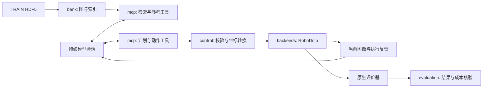

# RoboRAG 架构

RoboRAG 是同一个 Python 包中的分层框架。任务按独立目录组织，配置和专用工具归任务所有，运行器与底层协议共享。当前上线链路为图经验检索 + 持续模型会话 + MCP + RoboDojo；早期文本双记忆和独立视觉检索原型已退出当前代码。

## 一次回合如何运行

1. `runtime/episode.py` 读取 `RuntimeConfig`、`TaskSpec` 和提示词，记录布局、源码、图库和提示词哈希，启动仿真子进程与 MCP 服务。
2. `backends/simulation.py` 创建原生环境。`EpisodeAPI` 把相机图像、标定、双臂本体状态和控制反馈写入回合工作目录。
3. 模型通过 `observe` 读取当前图像与状态，通过 `retrieve_evidence` 查询 TRAIN 历史经验，必要时通过 `read_action_reference` 展开历史图像和动作片段。
4. 模型调用 `record_plan`，记录当前场景、新子目标、历史引用及调整方式。历史图不是当前场景的执行计划。
5. 模型调用 `execute_chunk`，提交 14D delta 行、重复行压缩或显式 TCP 目标。`control/targets.py` 将目标确定性转换为 delta；它不选择物体、接触点、子目标或执行时长。
6. MCP 的 `EpisodeSession` 通过 inbox/outbox 文件协议发给仿真进程。执行器返回实际前缀、跟踪误差或拒绝原因，工具同时返回最新图像，模型决定下一步。
7. RoboDojo 原生评价器决定成功。运行器保存结果和原始证据，`evaluation/` 离线核验完整性、动作步数和 token 使用量。

## 模块职责

`bank/models.py` 定义历史图及 cue/action/feedback 语义；`chunks.py` 定义动作窗口；`retrieval.py` 做分层检索；`store.py` 管理版本感知缓存与 HDF5 来源读取。`server.py` 仅负责图库 HTTP 展示，不进入策略执行链。

`mcp/server.py` 只负责工具组装。检索、观察、计划与动作工具位于 `mcp/`；cloth 和 planar 测量工具分别位于 `tasks/fold_clothes/` 与 `tasks/push_T/`，通过 `capabilities.py` 的轻量映射同时接入 MCP 和仿真端。`EpisodeSession` 保存本回合已检索引用、当前计划、锁及文件交换状态；它不是一个自动更新、自动检索的短期经验库。连续回合历史主要在模型会话和审计日志中。

`control/execution.py` 仅依赖 `ActionBackend` 协议，不直接操作原生环境的私有成员。`backends/robodojo.py` 实现具体派发、状态失效和日志写入。以后换后端需要实现这组能力，并重新验证坐标、终止条件和执行反馈；目前不宣称已有真机支持。

`runtime/` 管理进程、超时、中断和来源冻结，`evaluation/` 只读结果。模型工具不能用评价结果替代视觉反馈。

## fold_clothes 与 push_T 的差异

- fold_clothes：专用叠衣提示词，开放 `measure_scene`，读取当前 RGB 的布料几何；沿用 v3 动作行为。
- push_T：公共任务指令与专用提示词，开放 `measure_planar`；参考增加训练阶段首/中/末状态与图像；启用原生 IK 连续性检查，关节增量上限 0.25 rad。
- 其他 9 个任务保留各自的接入配置和提示词；尚未列入当前所选完整套件，不与这两套完整结果混算。`roborag tasks` 从 `results/current.json` 读取已记录策略的成绩与提交号。

上述开关在 `tasks/<任务名>/task.json` 中声明，经 `TaskSpec` 校验后由提示词、MCP 和仿真端共享。注册表自动发现任务目录；配置只选择已注册的工具能力，不执行任意 Python 导入。任务的专用实现留在自己的目录，有实际复用需求时再抽取为共享实现。

RoboRAG 的任务目录管理策略与工具，RoboDojo 的任务目录管理原生环境和成功判定。新增本库配置并不会自动实现新的仿真任务；两边必须有对应的任务标识。

## 与 HexaShell 的边界

RoboRAG 自己负责经验图、检索、模型计划、MCP 工具、运行记录和评估汇总。HexaShell 提供复用的运动学/机器人工具结构，以及 cloth、table_plane、planar_contact 的视觉几何实现。RoboICL 提供路径和环境接入，RoboDojo/Isaac Sim 负责动力学、原生动作派发和任务评价。

push_T 的几何工具只得到 RGB 与标定快照。fold 的旧测量适配器接收较完整的机器人 API，但仅允许列出的测量命令；该边界仍可继续收紧，需要作为单独行为变更验证。两者的几何检测都没有原生任务成功的判定权。

## 控制协议

动作一行是左右臂各 7 维：世界坐标平移 3 维、世界旋转向量 3 维、夹爪目标 1 维。控制频率 25 Hz，每次最多 24 行；每臂单行平移范数不超过 0.035 m，旋转范数不超过 0.35 rad。

TCP 到 link6 使用 0.145 m 的工具偏移。目标编译器插值的是 link6 平移及世界旋转，旋转时不保证 TCP 走直线。同一动作段从观测初值累计命令目标；实际跟踪误差超过 0.04 m 时停止剩余行。`return_home` 使用已验证的关节空间归位流程，不开放旧任意 TCP waypoint 控制器。

任务提示词位于 `tasks/<任务名>/prompt.txt`，公共机器人协议位于 `resources/prompts/`，工具自然语言说明位于 `resources/protocol/tool-descriptions.json`。说明从 Python 函数缩进中分离，避免格式化代码改变模型输入。黄金协议测试同时比较工具 schema、说明文本、提示词哈希与目标转换结果。

## 当前研究能力边界

检索是词法 BM25、显式条件及多样性选择，尚非学习型多模态检索。底层支持可选本体状态距离和 interaction 标注，但当前 MCP 请求未传入 state/stage/action_space，默认已验证图库也没有 interaction enrichment。因此“交互阶段感知和经验持续更新”仍有研究工作待完成，不能仅凭项目名称视为已验证贡献。

原始图库的部分匹配限制仅进入检索日志，没有全部进入模型上下文。这次重构保持既有输出；未来修复应建立新的策略版本和评估记录。
