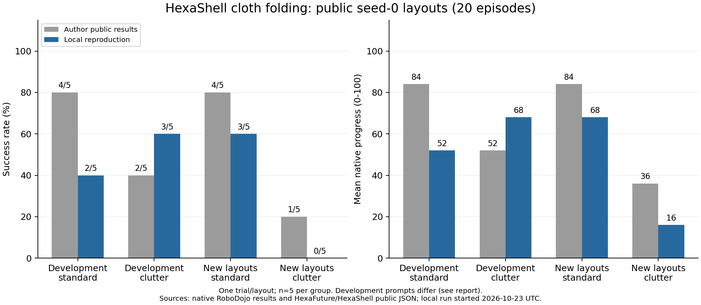
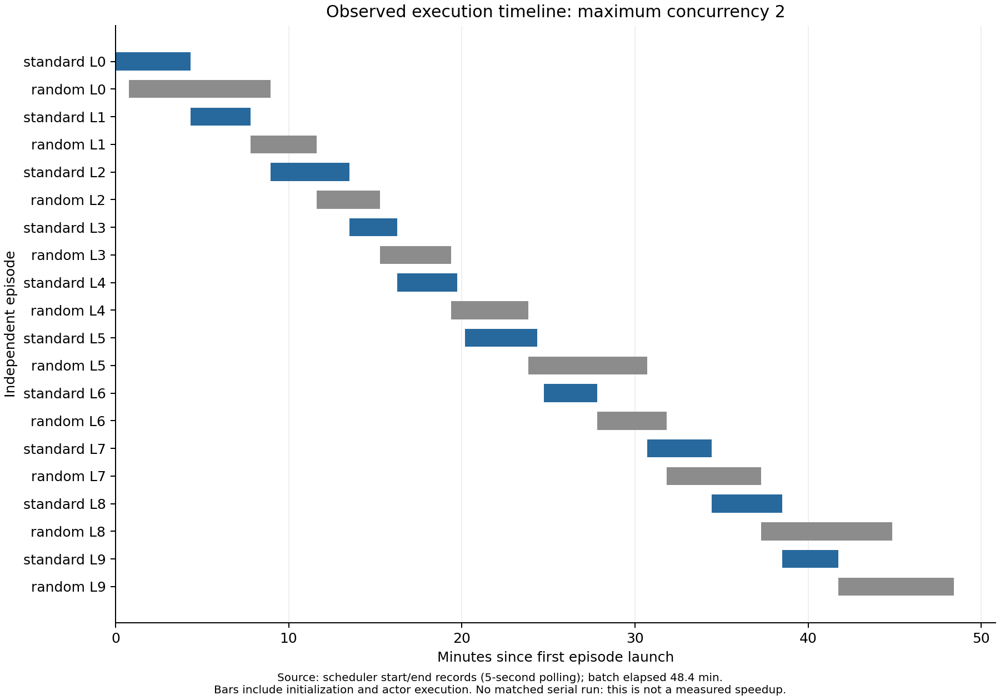

# HexaShell 叠衣复现

本工作属于 **RoboRAG: Interaction-Aware Retrieval-Augmented Manipulation** 的外部方法复现。
当前运行不启用 RoboRAG 检索，不作为项目拟贡献或检索有效性的证据。

**当前状态：公开 seed-0 的完整 20 回合测评已完成并通过核验。**
本地结果为 **8/20 成功（40%）、平均进度 51.0**。这是公开布局上的独立重建测评，
没有复核作者未公开种子的官方 50 回合结果。头部相机标定错误经独立实验确认并修复后，
20 个回合全部重新运行；修复前的 9 个回合及 2 个先导回合保留为历史诊断，消耗全部计入。
协议：[v2](../experiments/hexashell-fold-public-suite-v2.json)；
逐回合结果与消耗：[JSON](../results/hexashell-consumption-20261023.json)、
[CSV](../results/hexashell-consumption-20261023.csv)；
完成核验：[审计记录](../results/hexashell-completion-audit-20261023.json)。

## 最终结果与比较范围

标准和杂物场景各运行布局 0–9，每个布局一次，使用 GPT-6-Astra、xhigh、
原生持续 Codex CLI 会话、作者冻结工具和原生 RoboDojo 评分，没有按结果重试。

- 开发标准布局 0–4：本地 **2/5、进度 52**；作者公开 **4/5、84**。
- 开发杂物布局 0–4：本地 **3/5、进度 68**；作者公开 **2/5、52**。
- 新标准布局 5–9：本地 **3/5、进度 68**；作者公开 **4/5、84**。
- 新杂物布局 5–9：本地 **0/5、进度 16**；作者公开 **1/5、36**。

新布局总计本地 **3/10**、作者 **5/10**。本地结果没有达到作者公开数值。
开发集历史结果使用的提示早于 recipe、notes 和新规则，本地统一使用最终公开提示，
因此不能把整个 20 回合当作完全相同提示的对照。作者私有执行器、CLI 版本、模型快照
及逐资产等同性均未得到完整验证；每布局也只有一次试验，不据此推断显著的性能差异。
作者来源：[开发集](https://github.com/HexaFuture/HexaShell/blob/main/results/dev_layout_retests.json)、
[新布局](https://github.com/HexaFuture/HexaShell/blob/main/results/new_layout_tests.json)。



按布局 0–9 排列，标准场景原生得分为
`20, 100, 20, 100, 20, 20, 100, 100, 100, 20`；
杂物场景为 `20, 100, 100, 100, 20, 20, 20, 0, 20, 20`。
模型宣称完成、工具返回成功和最终任务成功分开记录；以上分数来自原生评分文件。

## 最终消耗

正式 20 回合的模型用量全部有 CLI 终态报告：输入 **11,540,197** token，
其中缓存输入 **10,682,496**、非缓存输入 **857,701**；输出 **60,516**，
其中推理输出 **28,091**。缓存与推理字段分别是输入、输出的细分，不重复相加。
这是一整轮多次模型交互的累计处理量，不是单次上下文长度。

RTX 4090 上最大并发为 2，整批墙钟时间 **2,905.27 s（48 分 25 秒）**；
各回合墙钟时间之和 **5,452.84 s（90 分 53 秒）**，两者分别记录。
实测吞吐约 **24.78 回合/小时**；没有匹配串行对照，不把二者比值宣称为加速倍数。
本机子进程累计 CPU 时间 **3,979.14 s**，整卡显存峰值 **22,261 MiB**。
采样覆盖 2,905.08 s，GPU 整卡能耗估算 **59.58 Wh**；该值含同卡后台程序，
不含 CPU、其他整机部件和云端模型推理能耗。



前期工作没有从消耗中删除：

- 修复标定前 9 个回合：输入 6,347,026（缓存 5,901,824），输出 38,554。
- 2 个先导回合：输入 1,334,375（缓存 1,256,704），输出 9,950。
- 18 次环境检查或启动尝试，其中 10 次启动 actor：已知输入 269,626（缓存 174,464），输出 2,917。

全部记录合计已知输入 **19,491,224**（缓存 **18,015,488**）、输出 **111,937**。
两次早期 actor 启动未返回终态用量，故全流程 token 合计是已知下限；正式 20 回合没有该缺口。
早期批次的部分 CPU、功率记录也缺失，账本明确标记，未用零代替。
本对话的编排 token/时间另存为 goal meter 快照，不与 actor 用量直接合成账单。
目标完成时，该 meter 为 **483,597 token、9,193 s（2 小时 33 分 13 秒）**。
此时间包含环境修复、测评、等待和报告，不是 CPU 时间；正式 20 回合的耗时仍为上面的 48 分 25 秒。

沿用已有 Codex 登录，未要求新的 API key。实际逐实验美元、人民币或 credit 扣费
没有可获取的账单，因此记为 **未知，而非零**。正式批次附近的全账户周额度快照
从已用 6% 变为 8%，期间可能有其他会话活动，不能把该变化独立归因于本实验。

20 个原生结果的内容与 SHA-256、8,907 条动作记录、20 份 actor 工作目录归档，
以及 440 项运行源码哈希均已核验。模型、依赖、提示、手册、布局和预算保持协议一致；
上游 HexaShell、RoboDojo 工作树无改动，所有本批 runner 已退出。
13 项接口/记账测试及独立相机渲染标定验证的记录见下文。

下面保留实现边界与调试过程；v1 结果均为历史记录，不混入正式成绩。

## 来源和目标

- 上游：[HexaFuture/HexaShell](https://github.com/HexaFuture/HexaShell)，固定提交
  `d1a2a24dc4c528a652b359fd689398530ef941d8`，Apache-2.0。
- 论文和 README 明确：执行 agent 和工具优化 agent 均为 **Codex + GPT-6-Astra**。
  Codex 是运行 agent 的程序，Astra 是模型，`robo` 是机器人命令接口。
- 上游只公开冻结工具、运动辅助代码和接口契约；未公开完整服务器、执行器、agent 容器和优化循环。
- 官方隐藏种子叠衣结果：标准场景 14/25 成功、平均进度 64.0；杂物场景 6/25 成功、
  平均进度 31.2；总计 20/50 成功、平均进度 47.6。
  来源：[官方结果](https://github.com/HexaFuture/HexaShell/blob/main/results/official_robodojo.json)。
- 作者公开标准开发布局为 seed 0 的 layout 0–4。本地先用 0、1 检验接口，
  再按 `experiments/hexashell-fold-public-standard-v1.json` 固定五个布局各运行一次。
  公开开发布局不能复核官方隐藏种子成功率，也不能估计泛化能力。

## 已实现的复现边界

`src/roborag/hexashell_adapter.py` 根据公开 `EpisodeAPI.md` 重建接口，
`src/roborag/hexashell_sim.py` 接入原生 RoboDojo，
`scripts/run_hexashell_fold.py` 管理模型推理、命令回执、日志和生命周期；
`src/roborag/hexashell_agent.py` 启动单个原生 Codex CLI 会话，保留其 shell、
读图、工具调用历史及原生上下文压缩。

保留上游 `enabled_tools.txt` 的六个工具目录，加载八条命令：
`surface_transfer`、`edge_transfer`、`crease_transfer`、`cloth_landmarks`、
`table_xy`、`table_plane`、`surface_outline`、`view_reacquire`。
原版工具、`geometry.py`、`motion.py` 和参数常量不作修改。

- 观测只有三路 RGB、相机标定和机器人本体状态；不提供深度、布料粒子、物体真值或评分状态。
- 标定使用实时相机位姿，明确把 USD 相机轴转换为 OpenCV 轴；提供原生名称与接口短名称别名。
- TCP 为末端链接沿工具 x 轴前移 0.145 m；实际运动使用上游直线 IK 和梯形速度规划。
- 关节轨迹经过原生 `take_action`，双臂同步，夹爪开合驻留 8 步；每步消耗原生预算。
- 保留原生 500 步、25 Hz（20 s 仿真运动时间）和 60 条运动命令限制。
- 原生 `run_eval` 和 reward checker 负责最终成功与进度。工具完成或模型宣称完成不算任务成功。
- 每次试验新建目录，保存源文件哈希、布局哈希、相机、动作、命令、推理输入与原生视频。
  中断和接口错误单独保存，不计入完整回合成绩。

## 与原方法的差异

1. 执行器是独立重建，不能声称与未公开服务器逐行相同。基础运动采用公开辅助代码，
   基础命令调度、反馈和观测刷新由本项目实现。
2. 默认使用单个持续运行的原生 `codex exec`，由模型自行读取操作手册和图像、
   调用 shell 中的 `robo`。每回合有独立目录和会话，原生文件权限限制仅开放其
   实验目录和最小系统运行路径；仿真源码、布局文件、粒子状态和评分文件不在可读范围内。
   作者使用的 CLI 版本、私有容器和模型服务端快照未公开，不能宣称完全相同。
   最初的逐命令 JSON 通道仅保留为 `--transport per-command` 诊断选项；
   用户要求保持原方法会话后，两个未完成启动均已中止，不作为正式复现成绩。
   本机 CLI 为 `0.155.0-alpha.16.3`。其 mountinfo 解析器不能处理系统 Snap 的
   `nsfs` 挂载根，因此外层使用最小 bubblewrap 文件系统命名空间排除这些挂载；
   内层仍执行 Codex 原生文件权限和禁网限制。系统运行文件与 CLI 二进制只读，
   登录文件仅对 CLI 本体挂载在原路径，对模型工具不可读；没有复制或导出凭据。
3. 使用 `gpt-6-astra`、`xhigh`；论文未指定推理强度，`xhigh` 是本地实验选择。
4. 使用既有固定版本 RoboDojo/Isaac Sim 和本地资产，未完成与作者运行环境的逐资产等同性认证。
5. 仅复现冻结工具的执行，不重做作者 12 小时工具优化过程，不在测试中修补冻结工具。
   作者 README 明确说明开发集成绩测于加入 recipe、notes 和新规则之前；本地 v2 全部使用
   最终公开 recipe 和 notes。因此开发集仅为相同布局的参考，不能称为完全相同提示的对照。
   新布局 5–9 的公开结果包含 recipe 和 notes，更适合对照当前冻结工具设置。
6. 第一批两个回合的 agent shell 未安装数值库（仿真端工具依赖齐全），
   layout 0 自编脚本因缺少 NumPy 失败。该批保留为先导实验。
   随后补齐 Python 3.10、NumPy、SciPy、Pillow、OpenCV、transforms3d；
   库以只读方式挂载，不扩大对仿真或评分数据的访问。
   五布局批次统一使用 `experiments/hexashell-agent-requirements.txt` 中的版本，
   不合并先导实验成绩，也不在批次中修改提示、工具或进行重试。

## 验证与运行

2026-10-23：8 个接口测试通过；现有 Codex 登录完成 Astra 读图调用，无需额外 API key。
第二次仿真检查中，原版 RGB 工具测得桌面 z=0.8047 m，提取到衣物关键点；
左臂上移 5 mm 后位置误差约 0.18 mm，再回到初始位置，共 6 步。
此检查不计任务分数。首次检查发现 reward 注册时序问题，保留原始失败记录。
首次正式启动也因发现重复注册风险而主动中止，不计成绩；随后调整为由原生 `run_eval`
完成一次注册后才发布初始观测。

完整回合运行状态以各次运行目录的 `result.json` 为准；
仅有 `ready.json`、模型输出或零退出码均不足以证明完成。
正常 agent 提前退出按原方法记作 `agent_exit` 失败，由原生 checker 保存当前进度；
模型鉴权、工具运行时和仿真基础设施错误属于未完成回合。

原生 Codex 的独立检查已实际通过 shell 文件读写、读图与文件隔离；
补齐依赖后再次通过全部五个 Python 库的导入、数值计算和生成图像的读取。

## 并发

论文报告每次运行使用一张 RTX 4090，复测回合墙钟时间中位数为 739 s，
其中大部分为模型延迟；未找到官方评测明确的同时运行回合数。
官方评测由 RoboDojo 团队在其自己的机器上运行，不应把“一张卡每次运行”
解释成整个评测只能串行。
来源：[论文](https://github.com/HexaFuture/HexaShell/blob/main/paper/HexaShell.pdf)、
[官方评测说明](https://github.com/HexaFuture/HexaShell/blob/main/results/official_robodojo.md)。
本地并发单位是独立 episode：各自有仿真进程、Codex 会话、命令队列和记录目录。
单回合的观察—动作—反馈顺序不改变。共享 GPU 的吞吐与单回合延迟分别记录，
未做匹配串行对照前，不声称获得确定倍数的加速。
并发能重叠不同回合的模型等待时间，但不会自动减少完成同样回合所需的 token。
资源竞争或服务端排队也可能增加单回合延迟，不能把并发数直接视为加速倍数。

`scripts/run_hexashell_batch.py` 支持并发 1 或 2，每个仿真完成初始化后才启动下一个，
并记录 GPU 显存、利用率、各回合起止时间。先导批次中两仿真各占约 9,190 MiB（9.0 GiB），
整卡峰值 19,014 MiB（含已有后台进程），两个回合总耗时约 600 s。
因此本机 RTX 4090 24 GiB 使用并发 2；不能直接把并发 3 当成可行配置。

使用 `local.runtime.json` 中的策略 Python：

```bash
python scripts/run_hexashell_fold.py --probe-only --output runs/hexashell-probe-new
python scripts/run_hexashell_fold.py --layout 0 --output runs/hexashell-fold-new
python scripts/run_hexashell_batch.py --layouts 0,1,2,3,4 --parallel 2 --output runs/hexashell-batch-new
python -m unittest discover -s tests -p test_hexashell_adapter.py -v
```

运行原生 actor 前，需要向 `data/hexashell-agent-python` 安装与系统 Python 3.10
匹配的依赖（不使用仿真环境的 Python 3.11 轮子）。本机安装方式为：

```bash
/usr/bin/python3 -m venv --without-pip /tmp/hexashell-agent-python-build
# 使用 local.runtime.json 中 policy_python 对应的 Python 执行下面这条 pip 命令：
python -m pip --python /tmp/hexashell-agent-python-build/bin/python install \
  --target data/hexashell-agent-python -r experiments/hexashell-agent-requirements.txt
```

该目标目录仅包含 Python 软件包。运行清单保存各包版本和 RECORD 哈希。
现有 Codex 登录由 CLI 使用，agent 工具无法读取登录文件；不需要另行提供 API key。

## 修复标定前的五回合结果（2026-10-23，历史诊断）

**执行流程和并发已跑通，但未复现作者的叠衣成功率。**
固定配置下，公开标准布局 0–4 各运行一次，原生得分依次为 **0、20、20、0、20**：
0/5 成功、平均进度 12.0。五个回合均有完整原生评测结果，无基础设施中断；
模型生成的最终文字不参与评分。作者公开的相同编号标准开发布局为 4/5 成功、
平均进度 84.0，不能以本地偶发成功代替这个差距。
来源：[作者开发集复测](https://github.com/HexaFuture/HexaShell/blob/main/results/dev_layout_retests.json)。

本地五回合批次墙钟时间 932.53 s（15 分 33 秒），最大并发 2，整卡峰值显存
19,058 MiB。没有匹配的串行对照，因此不报告加速倍数，也不把当前低成功率归因于并发。
所有回合的运行时源文件哈希一致；冻结的 HexaShell checkout 保持无改动。

先导批次单独记录：布局 0 得 20 分；布局 1 得 100 分、原生 success=true，
用 387 步、5 条占动作预算的命令，墙钟时间 280.28 s。该批 actor shell 缺少数值库，
不与上述五回合混合统计。补齐环境后的布局 1 得 20 分，二者动作不同，
没有依据把结果变化单独归因于新增依赖。

观察到的失败包括 RGB 桌面估计置信度不足、接触目标未到达，以及袖子或衣摆折叠不满足
原生条件。它们是日志中的现象，尚未通过消融实验确定各项原因的影响。
布局 3 在第 412 步由原生环境结束并得 0 分，尽管模型最终声称完成；
本报告依旧按原生结果计为失败。

机器可读摘要：`results/hexashell-reproduction-20261023.json`；
预先固定的实验方案：`experiments/hexashell-fold-public-standard-v1.json`。
每个回合的 `run.json`、`result.json`、命令日志、观测和原生视频位于
`runs/hexashell-public-standard-v1-20261023/standard-l{0..4}/`。

### 记录限制与修复

最终核对发现，轨迹中途被原生环境终止时，动作日志的末尾缓冲没有落盘：
先导布局 1 缺少末尾 18 步、正式布局 3 缺少末尾 13 步。原生评分文件和命令回执完整，
不改写既有结果或补造缺失动作。批次结束后已改为每步刷新日志并显式关闭文件；
8 项接口测试通过，其中提前终止测试直接从磁盘核对最后一步。
这项记录修复未重新跑五布局；原始运行仍保留当时的源文件快照。

原生 MP4 只含稀疏观测帧，并以 25 FPS 保存，不能当成逐物理步录像。
`runs/hexashell-reproduction-preview-20261023/pilot-layout1-observations.mp4`
仅将先导成功回合的同一批观测帧按每秒一帧展示，便于查看折叠阶段；
没有补造中间动作，也不表示真实时间。

上游依赖放在忽略的 `vendor/HexaShell`，原始许可证保留于该目录。
运行数据位于忽略的 `runs/`，适合版本控制的结果摘要已写入 `results/`。

## 公开测评 v1 与消耗账本

完整公开范围为 seed 0 的标准/杂物场景各 10 个布局：0–4 为开发集，5–9 为新布局，
总计 20 回合。原先的五个标准开发回合保留；其余 15 回合由
`experiments/hexashell-fold-public-suite-v1.json` 与
`experiments/hexashell-public-remaining-cases.json` 预先固定。
这属于作者公开复测协议，不冒充未公开种子的官方 50 回合测评。

延续部分只修复记录并增加消耗采样；模型、提示、冻结工具、运动参数、物理与评分不变。
各回合继续保存实际源码快照，明确区分记录器版本。没有根据成绩重试或挑选结果。

```bash
python scripts/run_hexashell_batch.py \
  --cases-file experiments/hexashell-public-remaining-cases.json --parallel 2 \
  --output runs/hexashell-public-remaining-v1-20261023
python scripts/summarize_hexashell.py
```

汇总器直接核验每个原生结果文件的内容和 SHA-256，并生成
`results/hexashell-consumption-20261023.json` 与同名 CSV。
它分别记录正式测评、先导试验和环境调试（包含失败启动）的消耗，不重复相加
`result.json` 中的副本与原始 CLI 事件日志。进行中的用量与历史缺失用量分开标记。

- 模型：输入、缓存输入、缓存写入、输出、推理输出。缓存输入属于输入，推理字段
  保留作输出细分，不重复加到总量。CLI 一个 turn 包含多轮模型/工具交互，不能视为一次 API 请求。
- 时间：单回合墙钟时间、agent 进程时间、整批墙钟时间。并发回合时间之和不是整批耗时。
- 本机资源：后续回合用 Linux `getrusage` 保存已回收子进程 CPU 时间及子进程峰值 RSS；
  每 5 秒采样并发进程 RSS、GPU 显存、利用率和整卡功率。
- 能耗：对 GPU 功率采样做梯形积分。该值包含同卡后台程序，不包含 CPU 等整机功率；
  也不包含云端模型推理能耗。前两批未采集功率，不能从显卡额定功率回填能耗。
- 磁盘：逐回合保存的文件逻辑字节数；不冒充网络下载流量或物理磁盘占用。
- 费用：沿用现有 Codex 登录，未取得逐实验账单，实际美元/人民币/credit 扣费为未知，
  不能写成零。订阅额度和 API token 定价不同；额度快照还是全账户共享的，不能独立归因于本实验。
  依据：[Codex 官方计费说明](https://learn.chatgpt.com/docs/pricing)，核对日期 2026-10-23。
- 编排开销：本会话 goal meter 的 token/时间另存为快照，不和 actor 用量直接合成账单。

已经完成的五个标准开发回合共报告输入 **3,208,789** token，其中缓存输入 **2,941,696**，
非缓存输入 **267,093**；输出 **18,729**，其中推理输出 **9,388**。
这些是多轮交互累计处理量，不是单次上下文长度，也不是已扣费金额。
完整结果与后续消耗以重新生成的账本为准。

## 相机标定证据与正式 v2 协议

检查发现，本地 RoboDojo 把头部相机 USD 的水平/垂直 aperture 设置为不匹配图像宽高比的值。
Isaac `Camera.get_intrinsics_matrix()` 据此返回 `fx=288.13, fy=336.46`，
而实际 RTX 图像使用方形像素，原生 `CameraManager.get_camera_intrinsics()` 也按 `fx=fy` 计算。
重建接口此前直接使用前者，导致传给模型和冻结工具的头部相机标定有误。

为验证这一点，`scripts/probe_hexashell_camera.py` 在独立场景中放置三个已知位置的彩色标记，
采用与头部相机相同的焦距、aperture 和图像分辨率，比较真实 RGB 标记中心与投影坐标。
该场景不运行机器人策略，不计任务分数，也不向评测 agent 提供物体真值。
原 SDK 内参的平均投影误差为 **8.98 像素**；方形像素内参的误差为 **0.71 像素**，
三个点均低于 1 像素。原始证据在
`runs/hexashell-camera-calibration-20261023-r4/calibration.json` 和同目录 `markers.png`。
此前三个未得到有效标定结果的探测启动也保留在消耗账本中。

接口现从实时水平 aperture、焦距与分辨率构造方形像素内参，保持正确的 USD→OpenCV 轴转换。
新回归测试以实际渲染的标记中心作为独立预期值；共 13 项接口/账本测试通过。
原生无评分检查进一步验证：layout 0 的 `table_plane` 返回 z=0.7649 m、置信度 1.0，
关键点提取正常，左臂上移 5 mm 的末端误差约 0.18 mm。
证据为 `runs/hexashell-probe-calibrated-20261023/`。

发现问题时仅暂停了 v1 的新回合调度；所有在途回合正常结束，没有中断动作或丢弃失败。
该延续批次实际完成杂物布局 0–3，得分 **20、20、100、20**；随后停止尚未启动的 11 个布局。
修复前的全部 9 个公开回合与先导结果不进入 v2 成功率，但其 token、时间与已有资源记录均保留。

v2 从头运行标准/杂物布局 0–9 共 20 回合，按布局交错两种场景，并发 2，每布局一次，
不优化工具、不按成绩重试。除了必要的相机接口修复与记录修复，模型、提示、运动参数、
资产和原生评分保持一致。本次使用的调度命令：

```bash
python scripts/run_hexashell_batch.py \
  --cases-file experiments/hexashell-public-v2-cases.json --parallel 2 \
  --output runs/hexashell-public-calibrated-v2-20261023
```

正式 v2 标准布局 1 已由原生评分器判定成功，得分 100；
`runs/hexashell-reproduction-preview-20261023/v2-standard-layout1-observations.mp4`
展示该回合原生头部相机的 15 张观测帧，按每秒一帧播放并明确标注非实时录像。
同名 JSON 保存源视频和输出视频哈希；未合成中间动作。
该成功例仅供查看折叠阶段，整体成绩采用全部 20 个回合。

账本会核验每回合布局哈希、六份本地源码快照与冻结上游源码哈希，
并核对整个 v2 的源码、手册和提示一致。已停止的 v1 延续批次以开始至停止时间
记录耗时（包含调度暂停），而不是使用暂停前的旧状态时间；功率缺测区间不填补。
已结束回合的 agent 工作目录另存为 `agent-workspace.tar.gz`，保留其脚本、笔记和
符号链接，不追踪链接到目录外的文件；同目录 `workspace-archive.json` 保存归档哈希。

## 本地执行回放前端（2026-10-24）

`web/hexashell-replay/` 展示正式 v2 的全部 20 回合，可按场景、原生任务结果筛选，
切换头部/左腕/右腕相机，播放 MP4，并点击命令跳转到执行后的观测。
操作详情保留原始参数、仿真步数、命令墙钟耗时、工具内部阶段和完整 JSON 回执。
页面明确区分原生任务成绩与工具的 `plan_ok` / `episode_over`。

在项目根目录运行：

```bash
python3 scripts/build_hexashell_replay.py
python3 scripts/serve_hexashell_replay.py --port 8793
```

浏览器打开 <http://127.0.0.1:8793>。生成的数据、60 个相机回放 MP4 及来源哈希位于
`runs/hexashell-replay-viewer-20261024/`；服务仅绑定本机，并只提供已登记的证据文件。
再次启动服务不需要重新生成视频；生成器也会按源帧与输出哈希复用未变的视频。

回放共有 238 条命令、258 个观测点（每回合初始帧 + 每条命令结束后的帧）。
第 n 条命令对应视频第 n 秒开始的观测，初始观测为第 0 秒。
视频以每秒一个观测点播放，编码为 10 fps 重复帧以兼容浏览器；**没有插值或合成中间运动，
不是连续动作录像，也不代表真实执行速度**。原始 MP4 保留独立下载入口，
它包含的稀疏观测可能比命令边界截图更多，不能用原始编码时间直接对应机器人时间。

构建及数据检查确认 20 回合、238 条命令与原始日志完全一致，774 个相机截图路径有效，
60 个视频的时长与观测数一致，60 个源文件哈希与60 个 MP4 HTTP Range 请求通过。
浏览器已验证 H.264 解码、播放推进、命令跳转、相机切换、场景/结果筛选和回合切换。
本前端只读取已有实验记录，不调用模型、不重新执行仿真、不改变原生评分。

### Codex 会话与控制 action 追溯

前端默认进入「Codex 实际会话」：展示原始任务提示、CLI 已记录的消息、shell/Python 请求、
未截断的原始 stdout、退出码，以及对应的 `robo` 命令。长输出默认折叠，可展开读取。
`runs/hexashell-replay-viewer-20261024/sessions/` 保存每回合的会话投影和全部控制 action。
会话事件标明 `agent-events.jsonl` 原始行号；投影文件保留源日志 SHA-256。

已验证全部 20 回合的 454 个可见 CLI item 原文（326 次 shell、88 条智能体消息、40 条运行提示），
以及额外的任务输入和回合结束事件。248 次 `robo` 请求中，238 次进入执行器，
另 10 次在任务结束后被客户端拒绝；后者保留在会话中，不计为新的机器人操作。
238 条执行命令与 `commands.jsonl` 顺序、参数及回执逐条匹配。

`actions.jsonl` 共记录 8,907 个已下发控制步，与每条命令的 `(step_before, step_after]` 区间精确对应。
详情中可滑动查看每一步的双臂关节目标与夹爪指令，以及相对回合初始关节的最大目标变化曲线。
这些 action 是工具、IK 和轨迹计时生成的执行指令，不是 GPT 直接输出的关节预测序列；
曲线也不是相机视频或实测轨迹。

本批次每次 shell 中的机器人请求都只有一条 `robo` 命令。standard-l0、standard-l1 和 random-l6
各出现一次两条 `table_xy` shell 调用的开始—结束区间重叠。CLI 日志没有逐次模型请求分组或
独立的看图工具事件，因此不能把 shell 调用次数当作模型推理次数，也不能恢复所有未记录的内部过程。

截图常见归位姿态有两个原因：感知命令不会推进物理仿真；成功的搬运工具通常在返回前执行
`--park home` 或双臂归位，而观测快照保存于整条工具返回后。例如 random-l5 的第 2 条
`cloth_landmarks` 仍是 step 0；第 15 条 `surface_transfer` 实际执行了 step 75–172 共 98 个控制步，
末步的双臂关节目标已经回到初始位置。此次没有保存连续动作相机帧，不能将末态截图解释为机器人没动。
